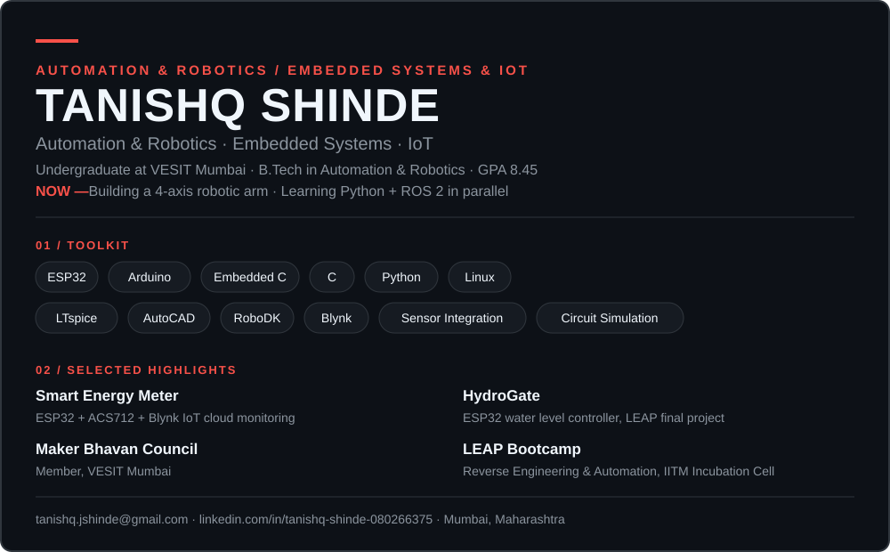

  

## Featured projects

- **[Smart Energy Meter](https://github.com/Tanishq-9307/smart-energy-meter)** — ESP32 + ACS712 current sensing with live power, energy and cost on an OLED and the Blynk IoT app, with 50% and 100% budget alerts.
- **[HydroGate](https://github.com/Tanishq-9307/hydrogate)** — Automated water level controller for a miniature dam model: HC-SR04 ultrasonic sensing, servo dam gate valve and relay pump control.

## Contact

- Email: tanishq.jshinde@gmail.com
- LinkedIn: [linkedin.com/in/tanishq-shinde-080266375](https://www.linkedin.com/in/tanishq-shinde-080266375)
- Location: Mumbai, Maharashtra

